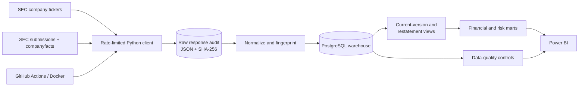

# Architecture and design decisions

## Key decisions

- **API mode for incremental refresh:** One submissions response and one Company Facts response per configured company. The response hash prevents unchanged payloads from being reparsed.
- **Bulk mode for future backfills:** The SEC recommends nightly bulk ZIP archives for large-volume retrieval. A production historical backfill should use those archives rather than issuing thousands of API calls.
- **Immutable lineage:** Every changed response is retained in JSONB with its endpoint, fetch timestamp, checksum, ETag, and run identifier.
- **Restatement safety:** Financial facts are append-only by fingerprint. The current view ranks versions by filing date and accession instead of overwriting history.
- **Semantic consistency:** A prioritized concept bridge maps common US-GAAP tags to canonical metrics. Source taxonomy, concept, unit, period, form, and accession remain available for audit.
- **Accounting-aware quality:** Reconciliation uses both a fixed materiality floor and a percentage tolerance. Failures remain visible; they are not silently modified.

## Scale path

The same configuration accepts 1–500 companies. For 500-company runs, use connection pooling, batch inserts, and the SEC bulk files for initial history. Partition large financial-fact tables by filed year after measuring actual warehouse volume.

